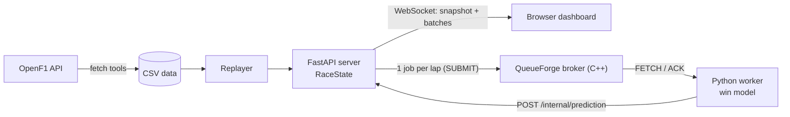

# PitWall

A live F1 race dashboard with real-time win probabilities. It replays a recorded race (the 2024 Italian GP, from the free [OpenF1](https://openf1.org) API) over a WebSocket, so the browser sees cars, gaps, tyres and telemetry arrive as if the race were live, and a trained model estimates each driver's chance of winning after every lap.


> It replays a recorded race. Nothing in the streaming or prediction path depends on the data being recorded, but no live feed is wired up in this repo.

## What it does

- Streams about 385,000 events for a 53-lap race (car telemetry for 20 cars, plus positions, gaps and laps) in time order, at a configurable speed (default 20x).
- A browser that joins late gets a full snapshot first, then batches of events about 20 times a second.
- The dashboard is one HTML file with no build step: a canvas track map, a leaderboard with gaps and tyres, a speed / throttle / brake trace for the selected driver, and win-probability bars. Cars that have stopped completing laps are marked OUT.
- After every lap the server asks a trained model for win probabilities. That work runs as a job on [QueueForge](https://github.com/Milind2805/QueueForge), my own C++ job queue.

## Architecture



## The win-probability model

**Data.** Race summaries (laps, tyre stints, positions, gaps) for 46 races from 2023 and 2024 (the 2023 Imola race was cancelled and is not in the data). Each race becomes one row per driver per lap, labelled with whether that driver went on to win. About 50,000 rows in total.

**Features** (all computed from what is known at that moment of the race; `app/features.py` is shared by training and the live server):

| feature | meaning |
|---|---|
| `laps_remaining`, `frac_done` | how much of the race is left |
| `position`, `gap`, `interval` | track position, seconds behind the leader, seconds behind the car ahead |
| `tyre_age`, `compound`, `pits_done` | tyre state and number of stops so far |
| `pace_delta` | median of the last 3 laps relative to the field's median |
| `lapped` | whether the car has been lapped |

**Model.** A gradient-boosting classifier (scikit-learn `HistGradientBoostingClassifier`). Predictions are normalised to sum to 1 across the field on each lap.

**Evaluation.** 8-fold cross-validation grouped by race, so every race is scored by a model that never saw it. Lower is better.

| | uniform guess | hand-written baseline | model |
|---|---|---|---|
| log loss, whole race | 2.906 | 1.605 | **0.782** |
| Brier score, whole race | 0.945 | 0.637 | **0.327** |
| log loss, first 25% of the race | 2.905 | 2.500 | **1.246** |
| log loss, 25 to 50% | 2.931 | 2.018 | **1.058** |
| log loss, 50 to 75% | 2.907 | 1.306 | **0.562** |
| log loss, last 25% | 2.879 | 0.573 | **0.249** |

**Calibration** (out of fold): when the model said 90 to 100%, the car won 92.8% of the time (mean prediction 95.5%, 1,002 rows). At 60 to 80% it was 72.2% against 71.1%. At the bottom end, cars given under 2% won 0.4% of the time against a mean prediction of 0.1%: the model is slightly too sure that back-markers cannot win.

**A miss worth knowing about.** In the live demo the model is trained without 2024 Monza. At lap 33 it gave the eventual winner (Leclerc, on a one-stop strategy) only about 5%. The features cannot see which strategies the other cars still have to run, and that is a limit of the data, not a bug.

## Engineering notes

- **Backpressure.** Each browser has a bounded queue. If one falls behind, the server drops its backlog and sends a fresh snapshot instead of leaving it with a hole in its state. Resyncs are counted in `/api/status`.
- **Training and serving use the same features.** `tools/check_features.py` replays Monza through the live server code and compares the result with the training rows. It caught a look-ahead leak in the first version of the dataset (training used a lap the live server could not have seen yet). Fixing it moved the whole-race log loss from 0.754 to 0.782, which is the honest number. After the fix every feature matches; gap and interval match on 98% of rows (mean difference 0.03 s and 0.08 s).
- **An OpenF1 quirk.** The position endpoint only records changes, so a driver who starts first and never loses the place has no rows inside the race window. Three 2024 races (Monaco, Singapore, Abu Dhabi) had no detectable winner, and other races silently lacked their non-moving drivers. The fetcher now also reads the pre-session grid rows.
- **Retired or missing cars.** A car with no completed lap for 3 or more laps is shown as OUT and excluded from the predictions. This rule cannot tell a retirement from missing data.

## QueueForge integration

The server builds the feature rows for a lap and submits one job (`SUBMIT <lap> predict <json>`). The priority is the lap number, so after any backlog the newest lap is served first. A Python worker `FETCH`es the job, runs the model, POSTs the result to `/internal/prediction` and ACKs it. Each result carries a run id and a lap number, and the server drops results from an earlier run of the race or older than the latest prediction. Delivery is at-least-once, so duplicates can happen and are harmless.

Set `PITWALL_QF=1` to use the queue. Without it the server predicts in-process.


Observed in a replay at 20x: 26 laps produced 26 jobs, with 0 dead, 0 visibility timeouts and a queue depth of at most 1.

| failure test | result |
|---|---|
| Stop the worker (Ctrl+C) mid-race | Queue depth rose to 16 jobs with nothing running; 0 dead. |
| Restart the worker | TODO: fill in after running the test (queue drain, newest lap first, stale results counted in `/api/status`). |
| `kill -9` the worker mid-job | TODO: fill in after running the test (job returns after the 15 s visibility timeout). |

## Run it

```bash
python -m venv .venv && source .venv/bin/activate
pip install -r requirements.txt

# 1. data (the API is rate-limited, so this takes a while; everything is cached on disk)
python tools/fetch_openf1.py 2024 Monza      # full telemetry for the race that gets replayed
python tools/fetch_summary.py 2023
python tools/fetch_summary.py 2024
python tools/build_dataset.py                # writes data/lap_dataset.csv

# 2. model
python tools/backtest.py                     # cross-validated scores and calibration
python tools/train_final.py 2024_Monza       # trains without the replayed race
python tools/check_features.py               # live features == training features

# 3. run (predictions in-process)
PITWALL_SPEED=20 uvicorn app.server:app --port 8000
```

Open http://127.0.0.1:8000. With the queue, start the QueueForge broker from its own repo (it listens on port 7000), then:

```bash
export QUEUEFORGE_ADDR=127.0.0.1:7000
python tools/predict_worker.py                                   # terminal 2
PITWALL_QF=1 PITWALL_SPEED=20 uvicorn app.server:app --port 8000 # terminal 3
```

| variable | default | meaning |
|---|---|---|
| `PITWALL_DATA` | `data/2024_Monza` | folder produced by `tools/fetch_openf1.py` |
| `PITWALL_SPEED` | `20` | replay speed, 1 = real time |
| `PITWALL_START` | `0` | start this many seconds into the race |
| `PITWALL_QF` | unset | `1` sends predictions through QueueForge |
| `QUEUEFORGE_ADDR` | `127.0.0.1:9000` | broker address (`host:port`) |
| `PITWALL_MODEL` | `models/win_model.joblib` | model file |
| `PITWALL_URL` | `http://127.0.0.1:8000` | where the worker POSTs results |

`GET /api/status` shows clients, events sent, dropped messages, resyncs and the queue counters.

## Layout

```
app/
  server.py       WebSocket server, RaceState, queue submit, /api/status
  replayer.py     merges telemetry, laps, positions and gaps into one time-ordered stream
  features.py     the model's features, shared by training and serving
  predictor.py    model loading, baseline formula, live_probs()
  qf_client.py    async client for the QueueForge text protocol
  static/index.html   the dashboard
tools/
  fetch_openf1.py, fetch_summary.py   data download (cached, throttled, retries)
  build_dataset.py, backtest.py, train_final.py, check_features.py
  predict_worker.py                   QueueForge worker
  ws_client.py, slow_client.py        load and slow-client tests
```

## Limitations

- It replays a recorded race; there is no live feed.
- The model only sees what is on the board. It cannot know strategy a team has not yet used (see the Monza lap 33 miss above).
- Two seasons of data. Rows from one race are highly correlated, so the calibration table is noisier than its row counts suggest.
- The baseline is a simple hand-written formula. A tuned position-and-gap-only model would be a fairer comparison and has not been tried.
- QueueForge is a single broker on one machine, so there is no failover.

Data from OpenF1. This project is unofficial and not affiliated with Formula 1.